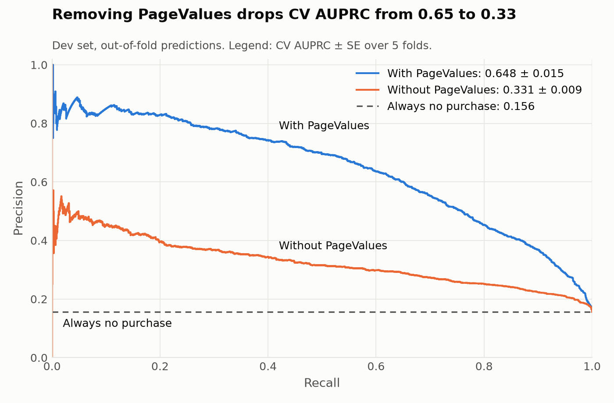

# Does an MLP Beat Logistic Regression at Predicting Online Purchases?

ESE 5420 final project. Team: Wenxi, Xingyu, Zhao.

We ask whether a tuned multilayer perceptron raises test AUPRC over tuned logistic regression by more than its error bar, on 12,330 e-commerce sessions in which about 15% end in a purchase. A tie is an acceptable answer. Because `PageValues` may leak the label, every result is reported with and without it.

> **Status: baseline checkpoint.** Logistic regression is complete on the CV folds. The MLP and the final test evaluation are not implemented yet, and the test set has not been scored. See [Roadmap](#roadmap).

## Results

CV AUPRC on the development set (stratified 5-fold, mean +/- SE, where SE = fold SD / sqrt(5)):

| Model | With `PageValues` | Without `PageValues` |
|---|---|---|
| Always no purchase (floor) | 0.156 | 0.156 |
| Logistic regression, L2 | **0.648 +/- 0.015** (C = 0.032) | **0.331 +/- 0.009** (C = 0.1) |
| MLP | not run | not run |

- These are not test scores. C was chosen on the same folds, so the means are slightly optimistic. Fold scores are correlated, so the SEs are approximate.
- **Effect of `PageValues`:** 0.317 +/- 0.014, paired by fold.
- **Pipeline check:** over 20 label shuffles, the model scores 0.159 +/- 0.001, matching random scores (0.159). This shows no sign of leakage through the pipeline. It cannot detect leakage inside `PageValues` itself.
- **Sensitivity:** keeping the 125 duplicate rows gives 0.644 +/- 0.013 with `PageValues` and 0.321 +/- 0.010 without.



## Installation

Python 3.11 or later.

```bash
conda create -n shoppers python=3.11 pip
conda activate shoppers
pip install -r requirements.txt
pip install -e .
```

## Reproducing the results

The raw data is included in `data/raw/`. Each experiment is one config in `configs/`:

```bash
for cfg in baseline keep_duplicates; do
  python scripts/make_splits.py    --config configs/$cfg.yaml   # shared split and folds
  python scripts/train_baseline.py --config configs/$cfg.yaml   # tune and score on the CV folds
  python scripts/make_figures.py   --config configs/$cfg.yaml   # PR curves
done
```

The whole run takes about 30 seconds on a laptop CPU. Outputs go to `results/<config>/` (`metrics.json`, `cv_curve.csv`, `oof_predictions.csv`) and `results/figures/`. `notebooks/baseline_walkthrough.ipynb` reads the saved results without retraining.

## Evaluation protocol

These rules are fixed before any test score exists:

1. **Split:** stratified 80/20 with seed 5420, then stratified 5-fold CV on the 80%. Every model uses `data/splits/splits.csv`, and `scripts/make_splits.py` refuses to replace a different split.
2. **Test set:** scored once, after all tuning is frozen. If a test score leads us to change anything, it is no longer an honest estimate. `shoppers.splits` has no function that returns test rows.
3. **No leakage in preprocessing:** scaling and encoding are fitted inside each training fold, through the pipeline.
4. **Metric:** AUPRC (`average_precision`).
5. **MLP seeds:** train over five seeds and report all of them, never the best.
6. **Decision rule:** bootstrap the paired test AUPRC difference (mean over MLP seeds minus logistic regression) over test rows, at least 2,000 resamples, with a 95% percentile interval. If the interval contains 0, the result is a tie.

## Data

[UCI Online Shoppers Purchasing Intention](https://archive.ics.uci.edu/dataset/468/online+shoppers+purchasing+intention+dataset), CC BY 4.0. See the [data card](data/README.md) for the columns and known issues.

## Repository structure

```text
configs/            one YAML file per experiment
data/               data card, raw CSV and shared splits
shoppers/           installable package
  config.py         reads a YAML config
  data.py           loading and column definitions
  splits.py         split creation; returns dev rows only
  models.py         shared preprocessing and model pipelines
  evaluate.py       CV tuning, floor and pipeline checks
  plotting.py       figures
scripts/            command-line entry points, run in the order above
results/            metrics and predictions per config; figures/
notebooks/          read-only walkthrough of saved results
reports/checkpoint/ course checkpoint submission
```

## Adding the MLP

`make_pipeline` attaches any scikit-learn classifier to the shared preprocessing, and `load_dev` returns the shared folds:

```python
from sklearn.neural_network import MLPClassifier
from shoppers.config import load_config
from shoppers.data import load_dataset
from shoppers.models import make_pipeline
from shoppers.splits import load_dev, read_splits

cfg = load_config("configs/baseline.yaml")
X, y = load_dataset(cfg.data_path, cfg.drop_duplicates)
X_dev, y_dev, folds = load_dev(X, y, read_splits(cfg.splits_path))

model = make_pipeline(
    MLPClassifier(hidden_layer_sizes=(32,), early_stopping=True, random_state=0),
    use_pagevalues=False,
)
```

With `early_stopping=True`, the stopping data is carved from the training fold, so the validation fold stays unseen.

## Roadmap

- [x] Data checks, shared split and folds
- [x] Tuned logistic regression, with and without `PageValues`
- [x] Pipeline checks and tests
- [ ] MLP tuned on the same folds, over five seeds
- [ ] Final test evaluation and paired bootstrap
- [ ] Confusion matrices and paper figures

## Citation

Dataset:

```bibtex
@article{sakar2019realtime,
  title   = {Real-time prediction of online shoppers' purchasing intention using multilayer perceptron and {LSTM} recurrent neural networks},
  author  = {Sakar, C. Okan and Polat, S. Olcay and Katircioglu, Mete and Kastro, Yomi},
  journal = {Neural Computing and Applications},
  volume  = {31},
  pages   = {6893--6908},
  year    = {2019}
}
```

## License

Dataset: CC BY 4.0. A license for the code has not been chosen yet.
